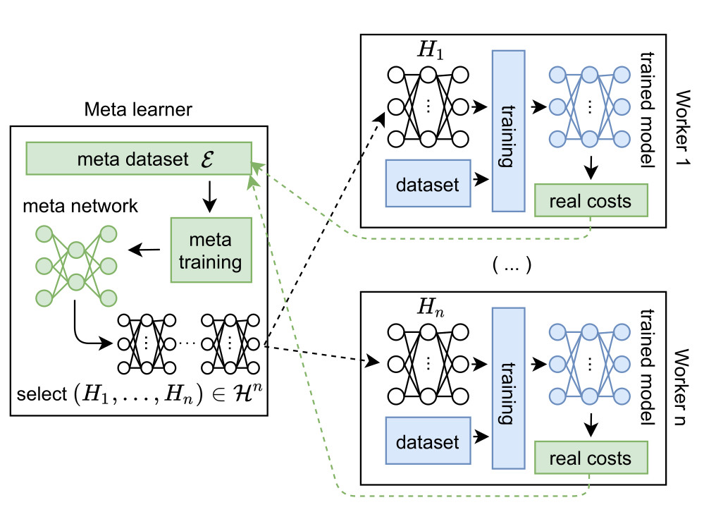

# Portiloop training



## Tutorials

Step-by-step, interactive tutorials (written for neuroscientists) on preprocessing, training, evaluating and deploying Portiloop models live in [`docs/`](docs/README.md) and are published with GitHub Pages at <https://portiloop.github.io/portiloop-training/> once Pages is enabled for this repository (Settings → Pages → branch `main`, folder `/docs`).

## Quick start guide

- clone the repo
- cd to the root of the repo (i.e., the folder where `setup.py` is)
- pip install with the -e option:
```terminal
pip install -e .
```
- get the synthetic practice dataset, either by downloading [dataset.zip](https://github.com/Portiloop/portiloop-training/releases/download/synthetic-dataset-v1/dataset.zip) and unzipping it inside `portiloop_software/` (it creates `portiloop_software/dataset/`), or by generating it (about two minutes, numpy and scipy only):
```terminal
python "portiloop_software/portiloop_python/Dataset generation/synthetic_dataset_generator.py"
```
- the pre-trained models are already in `portiloop_software/experiments` (the same checkpoints are in the original [experiments.zip](https://github.com/nicolasvalenchon/Portiloop/releases/download/v0.0.2/experiments.zip))

### About the data
The pre-trained models were trained on recordings of the [Montreal Archive of Sleep Studies (MASS)](https://ceams-carsm.ca/en/mass/) with spindle annotations from [MODA](https://osf.io/8bma7/). MASS recordings are available on request from their owners, so they are not distributed here: the dataset above is **synthetic EEG** in exactly the same format, so that the whole pipeline (training, hyperparameter search, evaluation, simulation) can be learned and tested. A network trained on it is not a detector for real EEG. To train on real data, obtain an annotated database (MASS with MODA, DREAMS Spindles, and others: see [tutorial 02](https://portiloop.github.io/portiloop-training/tutorials/02-installation.html#real-data)), preprocess it, and write it in the same format.

### Simulation:
The `simulate_Portiloop_1_input_classification.ipynb` [notebook](https://github.com/nicolasvalenchon/Portiloop/blob/main/notebooks/simulate_Portiloop_1_input_classification.ipynb) enables performing inference and analyzing the real-time performance of the neural network in terms of stimulation.
This notebook can be executed with `jupyter`.

### Offline inference:
We enable easily using out trained artificial neural network on your own data to detect sleep spindles (note that the data must be collected in the same experimental setting as MODA for this to work, see [our paper](https://arxiv.org/abs/2107.13473)).

This is easily done by writing your signal in a simple text file, on the model of the `example_data_not_annotated.txt` file provided with the practice dataset.

Importantly, note that your signal needs to be preprocessed with our `matlab` script to ensure the sampling frequency is 250Hz and to simulate the `Portiloop` online filtering operations. Please adapt and execute [this script](https://github.com/Portiloop/portiloop-training/blob/main/portiloop_software/matlab/preprocess_unannotated_data.m).

The output file can then be directly used for inference in our `offline_inference` [notebook](https://github.com/nicolasvalenchon/Portiloop/blob/main/notebooks/offline_inference.ipynb).

### Training:
Functions used for training are defined in python under the `portiloop_software` folder.
We provide [bash scripts examples](https://github.com/nicolasvalenchon/Portiloop/releases/download/v0.0.2/scripts.zip) for `SLURM` to train the model on HPC systems.
Adapt these scripts to your configuration.
Your training curves can be visualized in real time using [Weights & Biases](https://wandb.ai): log in with your own account (`wandb login`), optionally set `WANDB_ENTITY` to log to a team, or train without an account: `WANDB_MODE=offline` records the curves locally (upload them later with `wandb sync`), `WANDB_MODE=disabled` records nothing.

## License

This project is released under the [MIT License](LICENSE).
